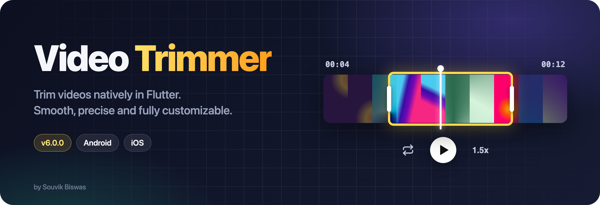
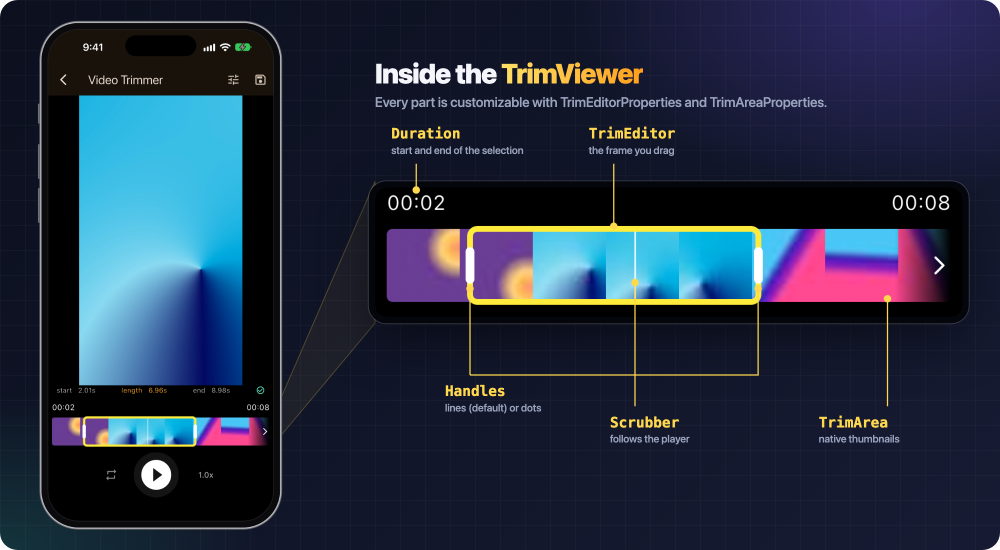
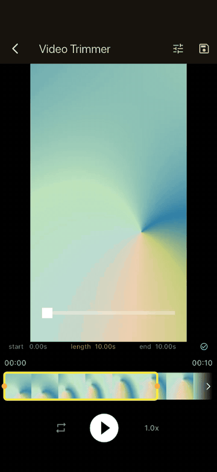

<a href="https://github.com/Solido/awesome-flutter">
   
</a>
<a href="https://pub.dev/packages/video_trimmer">
  
</a>
<a href="https://github.com/sbis04/video_trimmer/stargazers">
  
</a>
<a href="https://github.com/sbis04/video_trimmer/blob/main/LICENSE">
  
</a>

<p align="center">
  
</p>

<h4 align="center">A Flutter package for trimming videos</h4>

### Features

* Trim videos natively on Android and iOS, with no FFmpeg.
* Two trim viewers: a fixed one that shows the whole video, and a scrollable one for long videos, with smooth auto-scroll and a draggable timeline.
* Limit the selection with `maxVideoLength` and `minVideoLength`, or set them equal for a fixed-length selection.
* Restore a saved selection with `initialStartValue` / `initialEndValue`.
* Playback confined to the selection, which honors looping and playback speed and keeps the scrubber in sync with the player.
* Save the result as a video or a GIF.
* Line or dot drag handles, with the line height in pixels or as a percentage of the strip.
* Highly customizable: the trim frame, handles, thumbnails, durations, and scrolling behavior.

> **Upgrading from 5.x?** 6.0.0 has a few breaking changes. See [Migrating to 6.0.0](#migrating-to-600).

The `TrimViewer` consists of the `Duration` row on top (start, scrubber and end time), the `TrimArea` of thumbnails, and the `TrimEditor` overlay you drag to select a portion of the video.

<p align="center">
  
</p>

## Example

The [example app](https://github.com/sbis04/video_trimmer/tree/main/example) on an iPhone 18 Pro simulator. It is a playground for every option the package offers.

<p align="center">
  
</p>

## Installation

Add `video_trimmer` to your **pubspec.yaml**:

```yaml
dependencies:
  video_trimmer: ^6.0.0
```

**Android:** no setup needed.

**iOS:** no setup needed. The package works with both CocoaPods and Swift Package Manager. It needs no `Info.plist` keys of its own. If you let users pick videos from their library with a plugin such as `file_picker` or `image_picker`, add the usage description that plugin asks for (usually `NSPhotoLibraryUsageDescription`).

## Usage

### Load a video

Create one `Trimmer` per screen, load a file into it, and dispose of it when the screen goes away. The viewer widgets don't dispose of it for you.

```dart
final Trimmer _trimmer = Trimmer();

@override
void initState() {
  super.initState();
  _trimmer.loadVideo(videoFile: widget.file);
}

@override
void dispose() {
  _trimmer.dispose();
  super.dispose();
}
```

### Show the video

```dart
VideoViewer(trimmer: _trimmer)
```

### Show the trimmer

```dart
TrimViewer(
  trimmer: _trimmer,
  viewerHeight: 50.0,
  viewerWidth: MediaQuery.of(context).size.width,
  maxVideoLength: const Duration(seconds: 10),
  onChangeStart: (value) => _startValue = value,
  onChangeEnd: (value) => _endValue = value,
  onChangePlaybackState: (value) => setState(() => _isPlaying = value),
)
```

`onChangeStart` and `onChangeEnd` report milliseconds. `onChangePlaybackState` fires when playback starts or stops. `type` picks the viewer: `ViewerType.auto` (the default) uses the scrollable viewer when the video is longer than the trim area, and the fixed one otherwise.

For portrait videos, `areaProperties: TrimAreaProperties(thumbnailFit: BoxFit.cover)` fills the thumbnail strip without gaps.

### Play the selection

`videoPlaybackControl` toggles playback and returns `true` while playing. Playback starts from the trim start when the playhead is outside the selection, and stops at the trim end.

```dart
final playing = await _trimmer.videoPlaybackControl(
  startValue: _startValue,
  endValue: _endValue,
);
```

Looping and speed are set on the underlying player and are respected inside the selection:

```dart
_trimmer.videoPlayerController?.setLooping(true);     // wraps from end to start
_trimmer.videoPlayerController?.setPlaybackSpeed(2.0); // the scrubber keeps up
```

### Save the trimmed video

`saveTrimmedVideo` writes the selection to disk and passes the output path to `onSave`, or `null` if it failed.

```dart
await _trimmer.saveTrimmedVideo(
  startValue: _startValue,
  endValue: _endValue,
  onSave: (outputPath) => debugPrint('Saved to $outputPath'),
);
```

Optional parameters:
* `outputType: OutputType.gif` saves a GIF instead, tuned with `fpsGIF`, `scaleGIF` and `qualityGIF`.
* `storageDir` picks the directory (`StorageDir.temporaryDirectory`, `applicationDocumentsDirectory`, or Android-only `externalStorageDirectory`).
* `videoFolderName` and `videoFileName` name the output. The default name is `<source>_trimmed_<yyyyMMdd_HHmmss>`.

### Limit the selection length

`maxVideoLength` caps how long the selection can be, and `minVideoLength` sets how short it can get. Set them equal for a fixed-length selection that can only be moved.

```dart
TrimViewer(
  trimmer: _trimmer,
  maxVideoLength: const Duration(seconds: 30),
  minVideoLength: const Duration(seconds: 3),
)
```

### Restore a saved selection

Pass back the values that `onChangeStart` / `onChangeEnd` reported (in milliseconds) to open the trimmer on that range again. The scrollable viewer scrolls it into view, and the preview starts on its first frame. Either value can be given alone: the other is derived from `maxVideoLength`. So `initialEndValue: 3000` opens with the first 3 seconds selected, even when `maxVideoLength` is longer.

```dart
TrimViewer(
  trimmer: _trimmer,
  maxVideoLength: const Duration(seconds: 30),
  initialStartValue: saved.startMs, // e.g. 4000.0
  initialEndValue: saved.endMs,     // e.g. 9500.0
  onChangeStart: (value) => saved.startMs = value,
  onChangeEnd: (value) => saved.endMs = value,
)
```

### Customize

```dart
TrimViewer(
  trimmer: _trimmer,
  durationStyle: DurationStyle.FORMAT_MM_SS,
  editorProperties: TrimEditorProperties(
    borderPaintColor: Colors.yellow,
    borderWidth: 4,
    borderRadius: 5,
    circlePaintColor: Colors.white,           // handle color
    handleStyle: TrimHandleStyle.line,        // or TrimHandleStyle.circle
    handleHeight: TrimHandleHeight.percent(50), // or TrimHandleHeight.pixels(24)
  ),
  areaProperties: TrimAreaProperties.edgeBlur(
    thumbnailQuality: 10,
    // Scrollable viewer only:
    autoScrollEdgeZone: 48,       // px from each edge where auto-scroll kicks in
    maxAutoScrollVelocity: 1200,  // px per second at the very edge
    allowManualScroll: true,      // drag the strip itself
  ),
)
```

The [example app](https://github.com/sbis04/video_trimmer/tree/main/example) exposes every option on a settings screen, which is the quickest way to try them.

## Migrating to 6.0.0

* **Dispose the `Trimmer` yourself.** `VideoViewer` and `TrimViewer` no longer dispose it or its `VideoPlayerController`. Call `_trimmer.dispose()` from the `State` that created it.
* **`loadVideo` throws** a `FileSystemException` when the file doesn't exist, instead of doing nothing.
* **Default output names** changed from `<name>_trimmed:<localized date>` to `<name>_trimmed_<yyyyMMdd_HHmmss>`, which every platform and transcoder accepts.
* **`DurationStyle` keeps the largest unit.** For example, `FORMAT_MM_SS` renders 1h30m15s as `90:15` (it used to be `30:15`).
* **`onChangePlaybackState` fires on changes only**, not on every position update.
* **Handles are lines by default.** Set `handleStyle: TrimHandleStyle.circle` in `TrimEditorProperties` to keep the dots.
* **`StorageDir` is a real `enum`.** Usage is unchanged, but it can no longer be subclassed.
* **video_trimmer is now a plugin.** It generates thumbnails with its own native code instead of `get_thumbnail_video`, which fixes the iOS launch crash with `video_thumbnail` installed. Run `flutter clean` and `pod install` (iOS) after upgrading if your build complains.

See the [changelog](https://pub.dev/packages/video_trimmer/changelog) for the full list.

## Full example

A minimal app that picks a video, trims it, and saves it. Add `video_trimmer` and `file_picker` to your `pubspec.yaml`, then replace `lib/main.dart` with:

```dart
import 'dart:io';

import 'package:file_picker/file_picker.dart';
import 'package:flutter/material.dart';
import 'package:video_trimmer/video_trimmer.dart';

void main() => runApp(const MaterialApp(home: HomePage()));

class HomePage extends StatelessWidget {
  const HomePage({super.key});

  @override
  Widget build(BuildContext context) {
    return Scaffold(
      appBar: AppBar(title: const Text('Video Trimmer')),
      body: Center(
        child: ElevatedButton(
          child: const Text('LOAD VIDEO'),
          onPressed: () async {
            final picked = await FilePicker.pickFile(type: FileType.video);
            final path = picked?.path;
            if (path == null || !context.mounted) return;
            Navigator.of(context).push(MaterialPageRoute(
              builder: (_) => TrimmerView(File(path)),
            ));
          },
        ),
      ),
    );
  }
}

class TrimmerView extends StatefulWidget {
  const TrimmerView(this.file, {super.key});

  final File file;

  @override
  State<TrimmerView> createState() => _TrimmerViewState();
}

class _TrimmerViewState extends State<TrimmerView> {
  final Trimmer _trimmer = Trimmer();

  double _startValue = 0.0;
  double _endValue = 0.0;
  bool _isPlaying = false;
  bool _saving = false;

  @override
  void initState() {
    super.initState();
    _trimmer.loadVideo(videoFile: widget.file);
  }

  @override
  void dispose() {
    _trimmer.dispose();
    super.dispose();
  }

  Future<void> _save() async {
    setState(() => _saving = true);
    await _trimmer.saveTrimmedVideo(
      startValue: _startValue,
      endValue: _endValue,
      onSave: (outputPath) {
        if (!mounted) return;
        setState(() => _saving = false);
        ScaffoldMessenger.of(context).showSnackBar(SnackBar(
          content: Text(outputPath == null ? 'Saving failed' : 'Saved to $outputPath'),
        ));
      },
    );
  }

  @override
  Widget build(BuildContext context) {
    return Scaffold(
      backgroundColor: Colors.black,
      appBar: AppBar(
        title: const Text('Video Trimmer'),
        actions: [
          IconButton(
            icon: const Icon(Icons.save),
            onPressed: _saving ? null : _save,
          ),
        ],
      ),
      body: Column(
        children: [
          if (_saving) const LinearProgressIndicator(),
          Expanded(child: VideoViewer(trimmer: _trimmer)),
          TrimViewer(
            trimmer: _trimmer,
            viewerHeight: 50.0,
            viewerWidth: MediaQuery.of(context).size.width,
            maxVideoLength: const Duration(seconds: 10),
            onChangeStart: (value) => _startValue = value,
            onChangeEnd: (value) => _endValue = value,
            onChangePlaybackState: (playing) =>
                setState(() => _isPlaying = playing),
          ),
          IconButton(
            iconSize: 64,
            color: Colors.white,
            icon: Icon(_isPlaying ? Icons.pause : Icons.play_arrow),
            onPressed: () async {
              final playing = await _trimmer.videoPlaybackControl(
                startValue: _startValue,
                endValue: _endValue,
              );
              setState(() => _isPlaying = playing);
            },
          ),
        ],
      ),
    );
  }
}
```

## License

Copyright (c) 2026 Souvik Biswas

Permission is hereby granted, free of charge, to any person obtaining a copy
of this software and associated documentation files (the "Software"), to deal
in the Software without restriction, including without limitation the rights
to use, copy, modify, merge, publish, distribute, sublicense, and/or sell
copies of the Software, and to permit persons to whom the Software is
furnished to do so, subject to the following conditions:

The above copyright notice and this permission notice shall be included in all
copies or substantial portions of the Software.

THE SOFTWARE IS PROVIDED "AS IS", WITHOUT WARRANTY OF ANY KIND, EXPRESS OR
IMPLIED, INCLUDING BUT NOT LIMITED TO THE WARRANTIES OF MERCHANTABILITY,
FITNESS FOR A PARTICULAR PURPOSE AND NONINFRINGEMENT. IN NO EVENT SHALL THE
AUTHORS OR COPYRIGHT HOLDERS BE LIABLE FOR ANY CLAIM, DAMAGES OR OTHER
LIABILITY, WHETHER IN AN ACTION OF CONTRACT, TORT OR OTHERWISE, ARISING FROM,
OUT OF OR IN CONNECTION WITH THE SOFTWARE OR THE USE OR OTHER DEALINGS IN THE
SOFTWARE.
